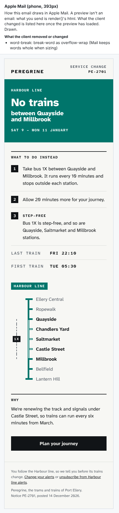
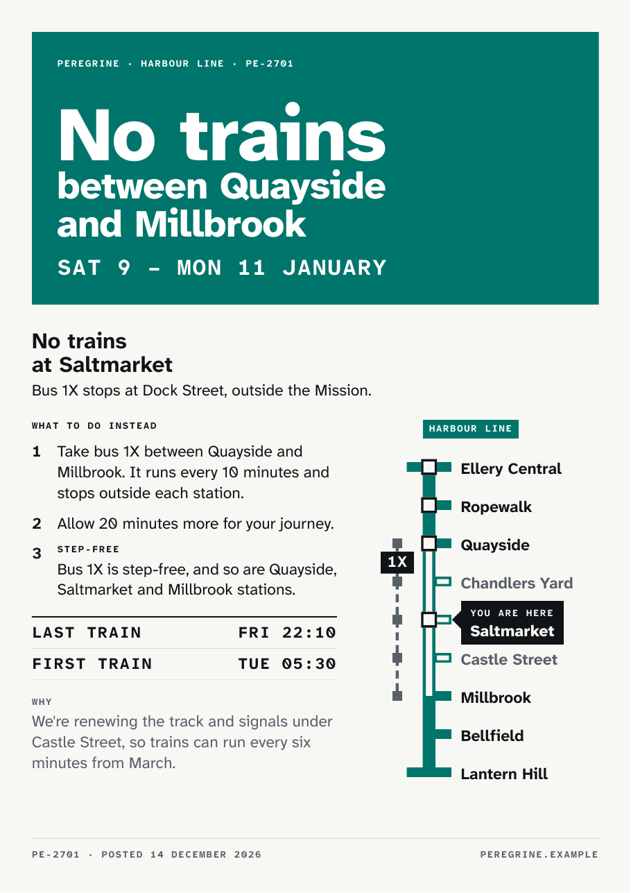

# Peregrine: transit notices a tired planner, or an agent, can't get wrong

**Give it the facts of a closure. It draws the line, writes the headline, makes a poster for every affected stop, and
refuses the notice that would strand someone.**

![Five A4 posters for the Harbour line closure between Quayside and Millbrook, the YOU ARE HERE marker stepping down one line diagram from poster to poster; below, the rider email on a phone, the social card, and check's own output: the notice written, and the same closure without a replacement bus refused at values.change[0].bus](docs/hero.png)

- **It refuses what would strand riders.** A closure with no replacement bus, a stop that isn't on the line, no
  step-free way through, no last train: `check` names the field and the fix, and nothing is drawn.
- **Every affected stop gets its poster.** One PDF with a page per stop, worked out from the closure, each with what
  the change means *there* and its own YOU ARE HERE. Nobody can forget Chandlers Yard.
- **The template writes the words and draws the line.** The headline comes from the facts ("No trains between
  Quayside and Millbrook") and reads the same in the email, on the posters and on the card. The email's line is drawn
  in table cells, with no images, so it reads with images off.
- **Built for agents.** An agent reads `describe`, writes a values file and fixes what `check` says. CI rejects any
  notice a template didn't check.

Peregrine is made with [Hyper Elements](https://github.com/hyper-elements/hyper-elements) `template()`: three templates
(an `Email`, a `Document` and a `Canvas`) that share one notice contract, one network and one brand. Peregrine, the
trams and trains of Port Ellery, is fictional.


## Try it in 2 minutes

You need Node 20 or newer.

```bash
git clone https://github.com/ayush00git/peregrine-notices && cd peregrine-notices && npm ci
```

```bash
npm run render
```

Then open, in `out/designs/pe-2701/`:

- `notice-email.html`: the rider email (open it in a browser)
- `stop-poster.a4.pdf`: five posters, one per affected stop
- `notice-card.landscape.png`: the social card

`pe-2702` (a skipped stop) and `pe-2703` (fewer trams) are next to it. To see a notice refused:

```bash
npx hyper-elements check designs/_refused/closure-without-bus.values.json
```

## What it refuses

Peregrine won't make a notice that would leave riders stuck. If something important is missing or wrong, it makes
nothing and says what to fix. For example, it refuses a notice that:

- closes a line but gives no replacement bus
- names a stop that isn't on that line, or misspells one
- doesn't say how wheelchair users get through
- has dates the wrong way round, or is posted less than a week ahead

A closure with no bus gets this, and no email, poster or card:

```text
error template/required at values.change[0].bus: Replacement bus is required
```

All 13 cases it refuses are in [`designs/_refused/`](designs/_refused), each checked by a test.

## What it makes

| Rider email | Stop poster (one of five) |
|---|---|
|  |  |

The email preview comes from Hyper Elements' email client emulator; [`docs/clients/`](docs/clients) has Outlook and Gmail too.

## Make your own notice

A notice is only the facts. Save this as `designs/my-notice/brief.json`:

```json
{
  "notice": "PE-2801",
  "posted": "2027-03-01",
  "starts": "2027-03-20",
  "ends": "2027-03-21",
  "change": [{
    "type": "coast.closure",
    "from": "Breakwater",
    "to": "Gull Point",
    "bus": { "route": "4C", "everyMinutes": 12 },
    "stepFree": "Bus 4C is step-free, and so are Breakwater and Gull Point.",
    "lastTrainBefore": "23:15",
    "firstTrainAfter": "06:00"
  }],
  "extraMinutes": 15,
  "reason": "We're replacing the tram rails along the seafront at Seaholme."
}
```

No headline, no colours, no list of stops for posters: the templates decide those. Make it for each template (each
checks it first), then render it into `out/designs/my-notice/`:

```bash
for t in notice-email stop-poster notice-card; do npx hyper-elements design new templates/$t.tsx -o designs/my-notice/$t.values.json --values designs/my-notice/brief.json; done
```

```bash
npx hyper-elements render designs/my-notice/
```

The change `type` is a line (`harbour`, `moor`, `viaduct`, `airport`, `coast`) and a kind (`closure`, `skip`,
`reduced`); the lines and their stops are in [`templates/_kit/network.ts`](templates/_kit/network.ts). Delete the bus,
or name a stop from another line, and it's refused. For agents, [`AGENTS.md`](AGENTS.md) has the loop and how to make
a notice from a GTFS-Realtime alert.

**Not a transit operator?** Ferries, campus shuttles, stadium gates, a building's lifts: the contract is the same
(what's closed, what to do instead, when, how much longer). Swap `network.ts` for your own.


## How it uses Hyper Elements

- Three `template()`s (an `Email`, a `Document` and a `Canvas`) share one set of typed fields, so one brief makes all
  three, and `check` refuses bad values by field before anything is drawn.
- The change's block types are generated from the network, one per line and kind, so each type's stops are only that
  line's: a stop on another line can't be written, even by an agent reading the JSON Schema.
- The poster template gives the PDF one `Document.Page` per affected stop, worked out from the change.
- The card fits its headline with `Heading fit`; for the email and posters, a test measures every headline the network
  can produce with `layoutImage()`.
- Notices are values files, made with `design new`; CI runs `check designs/ --require-template`.

The detail, the gallery copies and the notes from building it: [`docs/how-it-works.md`](docs/how-it-works.md).

## Checks

```bash
npm run check
```

```bash
npm test
```

The tests cover the 13 refusals, every headline's width, contrast, and the outputs (5, 2 and 6 poster pages; every
email under Gmail's 102 KB clip).

## In the Hyper Elements gallery

[`gallery/`](gallery) has each template as one file, in the shape of the gallery's own: `export const meta` and a
default export that draws the example. `npm run gallery` regenerates them and renders them as the site's generator
does.

## License

MIT
